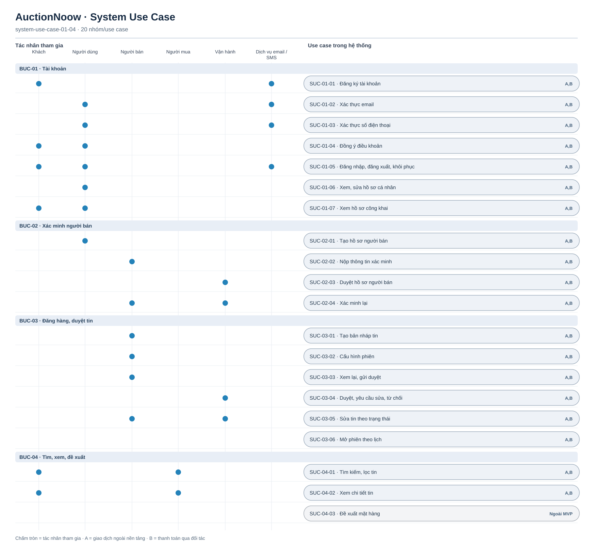

# System Use Case — tài khoản, tin đăng, tìm kiếm

[Tổng quan](system-use-case-overview.md) · BUC-01–04 · 20 SUC. Nhãn `A,B` áp dụng cả hai tầng; `Ngoài MVP` không thuộc phạm vi phát hành. Tác vụ tự động nằm trong ranh giới hệ thống, không có tác nhân ngoài.

[Nguồn Mermaid](system-use-case-01-04.mmd)

SUC-03-06 là tác vụ theo lịch trong hệ thống. SUC-04-03 là đề xuất ngoài MVP, chưa có FR/TC được duyệt. Đường nối chỉ biểu thị tác nhân tham gia.
