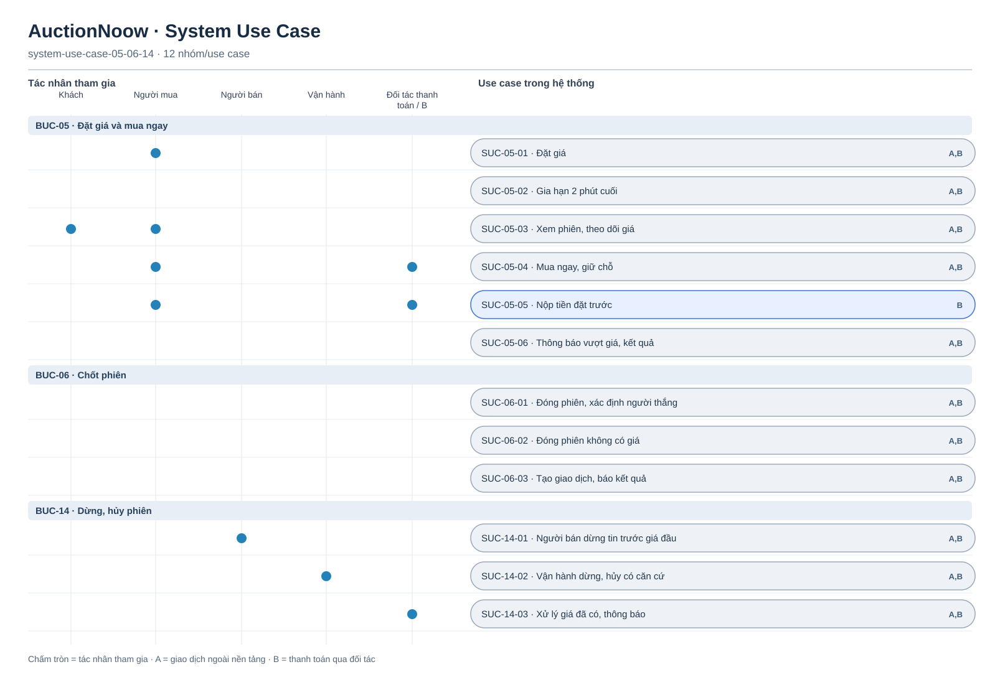

# System Use Case — đấu giá, chốt và dừng phiên

[Tổng quan](system-use-case-overview.md) · BUC-05–06, 14 · 12 SUC. `A,B` áp dụng cả hai tầng; `B` chỉ mở khi có đối tác và đạt cổng pháp lý. Ở A, mua ngay tạo giao dịch thử nghiệm và hai bên có thể tự thanh toán ngoài nền tảng; hệ thống không xác nhận tiền.

[Nguồn Mermaid](system-use-case-05-06-14.mmd)

SUC-05-02, 05-06, 06-01–03 và 14-03 được hệ thống kích hoạt theo sự kiện hoặc lịch; vì vậy không nối với tác nhân ngoài chỉ để lấp sơ đồ. Đường nối đối tác tới SUC-05-04 và 14-03 chỉ áp dụng ở B.
