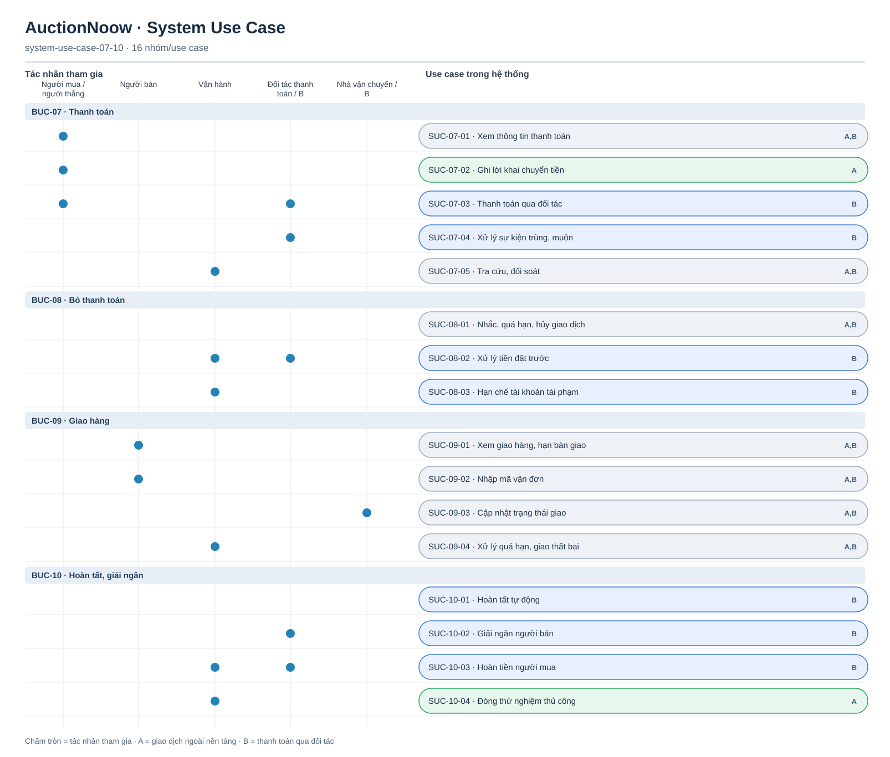

# System Use Case — thanh toán, giao hàng, hoàn tất

[Tổng quan](system-use-case-overview.md) · BUC-07–10 · 16 SUC. `A` ghi nhận giao dịch ngoài nền tảng, không xác nhận tiền; `B` có thanh toán, giữ, hoàn và giải ngân qua đối tác. `A,B` áp dụng cả hai tầng.

[Nguồn Mermaid](system-use-case-07-10.mmd)

SUC-07-05 ở A chỉ tra cứu lời khai, không đối soát tiền với đối tác. SUC-10-04 đóng thử nghiệm sau khi vận hành xem bằng chứng và không có tranh chấp mở; nó không xác nhận đã thanh toán. Các tác vụ tự động không được vẽ như tác nhân bên ngoài.
