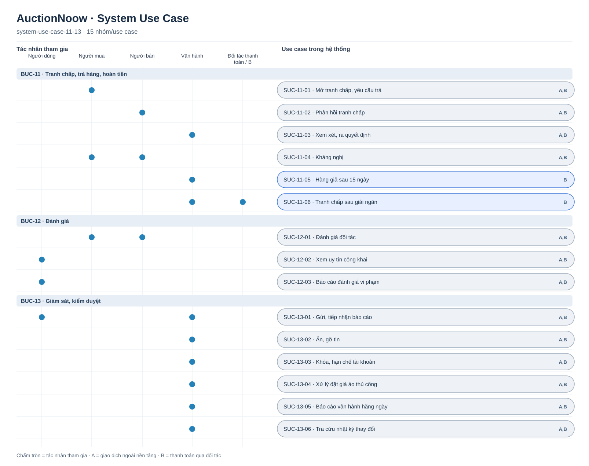

# System Use Case — tranh chấp, đánh giá, vận hành

[Tổng quan](system-use-case-overview.md) · BUC-11–13 · 15 SUC. `A,B` áp dụng cả hai tầng; `B` chỉ áp dụng thanh toán bảo đảm qua đối tác. Ở A, vận hành xem tranh chấp về giao dịch ngoài nền tảng nhưng hệ thống không hoàn tiền.

[Nguồn Mermaid](system-use-case-11-13.mmd)

SUC-11-05 và 11-06 chỉ thuộc B. Ở A, tranh chấp đang mở chặn việc vận hành đóng giao dịch thử nghiệm; mọi thỏa thuận hoàn trả tiền ngoài nền tảng chỉ được ghi nhận như thông tin do hai bên cung cấp. Đường nối chỉ biểu thị tác nhân tham gia.
