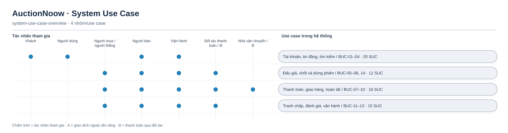

# Sơ đồ System Use Case — tổng quan

Các sơ đồ chi tiết được chia theo bốn nhóm để 63 SUC vẫn đọc được. Mỗi mã trong hình tương ứng một file đặc tả tại [mục lục 03](../03-use-cases-user-flows.md). `A` là thử nghiệm kín: hai bên có thể giao dịch tiền thật ngoài nền tảng, nhưng hệ thống chỉ ghi lời khai chưa đối soát. `B` là thanh toán bảo đảm qua đối tác sau cổng phát hành.

[Nguồn Mermaid](system-use-case-overview.mmd)

- [Tài khoản, tin đăng, tìm kiếm — BUC-01–04](system-use-case-01-04.md)
- [Đấu giá, chốt và dừng phiên — BUC-05–06, 14](system-use-case-05-06-14.md)
- [Thanh toán, giao hàng, hoàn tất — BUC-07–10](system-use-case-07-10.md)
- [Tranh chấp, đánh giá, vận hành — BUC-11–13](system-use-case-11-13.md)

Các tác vụ tự động nằm trong ranh giới hệ thống và không được biểu diễn như tác nhân bên ngoài. Đường nối thể hiện tác nhân tham gia, không hàm ý thứ tự thực hiện hay quan hệ `include`/`extend`.
