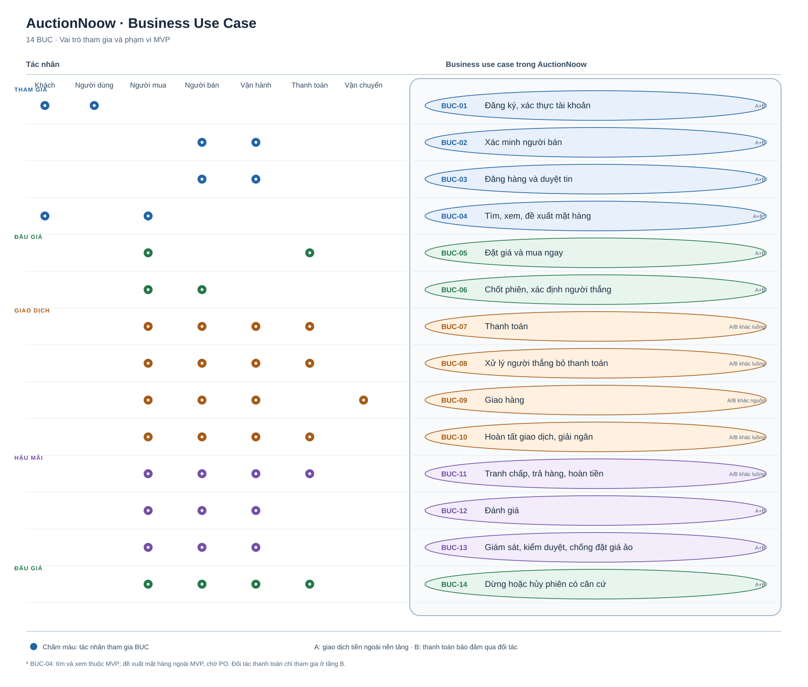
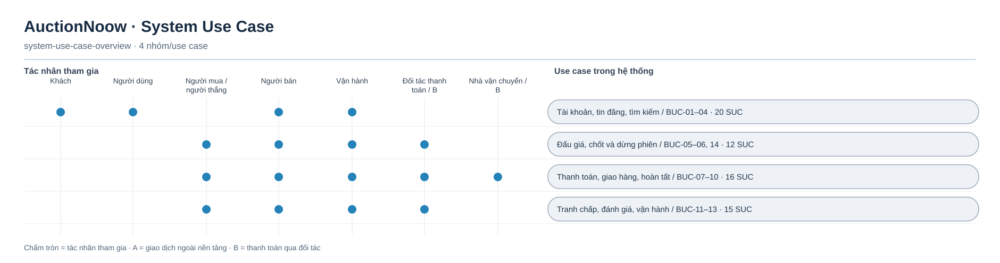

# 03 — Use Cases & User Flows

Tài liệu này là mục lục cho các BUC và SUC. Luồng nghiệp vụ dựa trên `01`, `01b`, `02`; các tham số ghi `Đề xuất` chưa trở thành quyết định PO. `[A]` là thử nghiệm kín với người và hàng thật: hai bên có thể tự thanh toán, giao hàng ngoài nền tảng, nhưng hệ thống không xác nhận hoặc bảo vệ tiền. `[B]` là thanh toán bảo đảm bằng tiền thật qua đối tác sau cổng đối tác và pháp lý.

## Sơ đồ Business Use Case

[Bản nguồn PlantUML](03-business-use-cases/business-use-case-diagram.puml) để chỉnh sửa sơ đồ. Dấu chấm trong hình cho biết tác nhân tham gia BUC; tác vụ tự động như đóng phiên nằm trong ranh giới hệ thống.

## Sơ đồ System Use Case

[Sơ đồ tổng quan và mục lục](03-system-use-cases/system-use-case-overview.md) dẫn tới bốn ảnh SVG theo nhóm: [tài khoản, tin đăng, tìm kiếm](03-system-use-cases/system-use-case-01-04.svg), [đấu giá và chốt phiên](03-system-use-cases/system-use-case-05-06-14.svg), [thanh toán, giao hàng, hoàn tất](03-system-use-cases/system-use-case-07-10.svg), [tranh chấp, đánh giá, vận hành](03-system-use-cases/system-use-case-11-13.svg). Các hình dùng đúng mã `SUC` bên dưới và ghi tầng áp dụng; dấu chấm biểu thị tác nhân tham gia, không biểu thị thứ tự luồng. Bản nguồn Mermaid được liên kết trong từng trang sơ đồ.

| BUC | Nhóm | SUC |
|---|---|---|
| BUC-01 | Đăng ký, xác thực tài khoản | [SUC-01-01](03-system-use-cases/SUC-01-01-dang-ky-tai-khoan.md), [SUC-01-02](03-system-use-cases/SUC-01-02-xac-thuc-email.md), [SUC-01-03](03-system-use-cases/SUC-01-03-xac-thuc-so-dien-thoai.md), [SUC-01-04](03-system-use-cases/SUC-01-04-dong-y-dieu-khoan.md), [SUC-01-05](03-system-use-cases/SUC-01-05-dang-nhap-dang-xuat-khoi-phuc-truy-cap.md), [SUC-01-06](03-system-use-cases/SUC-01-06-xem-va-sua-ho-so-ca-nhan.md), [SUC-01-07](03-system-use-cases/SUC-01-07-xem-ho-so-cong-khai-cua-nguoi-khac.md) |
| BUC-02 | Xác minh người bán | [SUC-02-01](03-system-use-cases/SUC-02-01-tao-ho-so-nguoi-ban-chon-loai.md), [SUC-02-02](03-system-use-cases/SUC-02-02-nop-thong-tin-xac-minh.md), [SUC-02-03](03-system-use-cases/SUC-02-03-duyet-ho-so-nguoi-ban.md), [SUC-02-04](03-system-use-cases/SUC-02-04-xac-minh-lai-khi-het-hieu-luc.md) |
| BUC-03 | Đăng hàng và duyệt tin | [SUC-03-01](03-system-use-cases/SUC-03-01-tao-ban-nhap-tin.md), [SUC-03-02](03-system-use-cases/SUC-03-02-cau-hinh-phien-dau-gia.md), [SUC-03-03](03-system-use-cases/SUC-03-03-xem-lai-tong-hop-va-gui-duyet.md), [SUC-03-04](03-system-use-cases/SUC-03-04-duyet-yeu-cau-sua-tu-choi-tin.md), [SUC-03-05](03-system-use-cases/SUC-03-05-sua-tin-theo-trang-thai-cho-phep.md), [SUC-03-06](03-system-use-cases/SUC-03-06-mo-phien-theo-lich-chup-quy-tac.md) |
| BUC-04 | Tìm, xem, đề xuất mặt hàng | [SUC-04-01](03-system-use-cases/SUC-04-01-tim-kiem-va-loc-tin.md), [SUC-04-02](03-system-use-cases/SUC-04-02-xem-chi-tiet-tin.md), [SUC-04-03](03-system-use-cases/SUC-04-03-de-xuat-mat-hang.md) |
| BUC-05 | Đặt giá và mua ngay | [SUC-05-01](03-system-use-cases/SUC-05-01-dat-gia.md), [SUC-05-02](03-system-use-cases/SUC-05-02-gia-han-o-2-phut-cuoi.md), [SUC-05-03](03-system-use-cases/SUC-05-03-xem-trang-phien-theo-doi-gia.md), [SUC-05-04](03-system-use-cases/SUC-05-04-mua-ngay-va-giu-cho.md), [SUC-05-05](03-system-use-cases/SUC-05-05-nop-tien-dat-truoc.md), [SUC-05-06](03-system-use-cases/SUC-05-06-thong-bao-bi-vuot-gia-va-ket-qua-phien.md) |
| BUC-06 | Chốt phiên | [SUC-06-01](03-system-use-cases/SUC-06-01-dong-phien-xac-dinh-nguoi-thang.md), [SUC-06-02](03-system-use-cases/SUC-06-02-dong-phien-khong-co-gia-hop-le.md), [SUC-06-03](03-system-use-cases/SUC-06-03-tao-giao-dich-thong-bao-ket-qua.md) |
| BUC-07 | Thanh toán | [SUC-07-01](03-system-use-cases/SUC-07-01-xem-thong-tin-thanh-toan.md), [SUC-07-02](03-system-use-cases/SUC-07-02-ghi-nhan-thanh-toan-tu-khai.md), [SUC-07-03](03-system-use-cases/SUC-07-03-thanh-toan-qua-doi-tac.md), [SUC-07-04](03-system-use-cases/SUC-07-04-xu-ly-su-kien-thanh-toan-trung-hoac-muon.md), [SUC-07-05](03-system-use-cases/SUC-07-05-tra-cuu-doi-soat-thanh-toan.md) |
| BUC-08 | Người thắng bỏ thanh toán | [SUC-08-01](03-system-use-cases/SUC-08-01-nhac-phat-hien-qua-han-huy-giao-dich.md), [SUC-08-02](03-system-use-cases/SUC-08-02-xu-ly-tien-dat-truoc-khi-bo-thanh-toan.md), [SUC-08-03](03-system-use-cases/SUC-08-03-han-che-tai-khoan-tai-pham.md) |
| BUC-09 | Giao hàng | [SUC-09-01](03-system-use-cases/SUC-09-01-xem-thong-tin-giao-hang-han-ban-giao.md), [SUC-09-02](03-system-use-cases/SUC-09-02-nhap-ma-van-don.md), [SUC-09-03](03-system-use-cases/SUC-09-03-cap-nhat-theo-doi-trang-thai-giao-hang.md), [SUC-09-04](03-system-use-cases/SUC-09-04-xu-ly-qua-han-gui-giao-that-bai.md) |
| BUC-10 | Hoàn tất, giải ngân | [SUC-10-01](03-system-use-cases/SUC-10-01-hoan-tat-giao-dich-tu-dong.md), [SUC-10-02](03-system-use-cases/SUC-10-02-giai-ngan-cho-nguoi-ban.md), [SUC-10-03](03-system-use-cases/SUC-10-03-hoan-tien-cho-nguoi-mua.md), [SUC-10-04](03-system-use-cases/SUC-10-04-dong-giao-dich-thu-cong.md) |
| BUC-11 | Tranh chấp, trả hàng, hoàn tiền | [SUC-11-01](03-system-use-cases/SUC-11-01-mo-tranh-chap-yeu-cau-tra-hang.md), [SUC-11-02](03-system-use-cases/SUC-11-02-phan-hoi-tranh-chap.md), [SUC-11-03](03-system-use-cases/SUC-11-03-xem-xet-ra-quyet-dinh.md), [SUC-11-04](03-system-use-cases/SUC-11-04-khang-nghi.md), [SUC-11-05](03-system-use-cases/SUC-11-05-xu-ly-hang-gia-phat-hien-sau-15-ngay.md), [SUC-11-06](03-system-use-cases/SUC-11-06-tranh-chap-sau-giai-ngan.md) |
| BUC-12 | Đánh giá | [SUC-12-01](03-system-use-cases/SUC-12-01-danh-gia-doi-tac.md), [SUC-12-02](03-system-use-cases/SUC-12-02-xem-uy-tin-cong-khai.md), [SUC-12-03](03-system-use-cases/SUC-12-03-bao-cao-danh-gia-vi-pham.md) |
| BUC-13 | Giám sát, kiểm duyệt | [SUC-13-01](03-system-use-cases/SUC-13-01-gui-tiep-nhan-bao-cao.md), [SUC-13-02](03-system-use-cases/SUC-13-02-an-go-tin.md), [SUC-13-03](03-system-use-cases/SUC-13-03-khoa-han-che-tai-khoan.md), [SUC-13-04](03-system-use-cases/SUC-13-04-phat-hien-xu-ly-dat-gia-ao-thu-cong.md), [SUC-13-05](03-system-use-cases/SUC-13-05-bao-cao-van-hanh-hang-ngay.md), [SUC-13-06](03-system-use-cases/SUC-13-06-tra-cuu-nhat-ky-thay-doi.md) |
| BUC-14 | Dừng, hủy phiên | [SUC-14-01](03-system-use-cases/SUC-14-01-nguoi-ban-dung-tin-truoc-luot-gia-dau.md), [SUC-14-02](03-system-use-cases/SUC-14-02-van-hanh-dung-huy-phien-co-can-cu.md), [SUC-14-03](03-system-use-cases/SUC-14-03-xu-ly-luot-gia-da-co-thong-bao.md) |

## Ranh giới cần giữ khi triển khai

- Tầng A chỉ ghi lời khai chuyển khoản ngoài nền tảng là `người thắng khai, chưa đối soát`; không xác nhận đã thanh toán hay giải ngân.
- Tầng B chỉ mở sau khi đạt cổng đối tác giữ tiền và rà pháp lý. Tiền đặt trước, thanh toán, hoàn và giải ngân phải đối soát với đối tác.
- Lượt giá hợp lệ được xác nhận theo thứ tự máy chủ. Lượt trong 2 phút cuối đặt giờ đóng mới bằng thời điểm xác nhận cộng 2 phút; đóng phiên và tạo giao dịch không được lặp kết quả.
- `SUC-04-03` nằm ngoài MVP và chưa có FR/TC được duyệt.

## Chỗ còn phải đồng bộ

- Tầng A đóng giao dịch thử nghiệm thủ công theo SUC-10-04 và TC-110 đến TC-113; mốc 15 ngày để tự hoàn tất và giải ngân chỉ áp dụng tầng B.
- M-D1 và M-D2 đã chọn hướng chia tầng và cho phép hai bên tự giao dịch ngoài nền tảng ở A. M-D3, M-D4, M-S1, M-D5 cùng các chi tiết còn mở của D-04, D-08, D-09 và tham số P được ghi ở SUC liên quan; không tự coi chúng đã chốt.
- BUC và file đặc tả cùng dùng mã `SUC-xx-yy` cho use case hệ thống.

