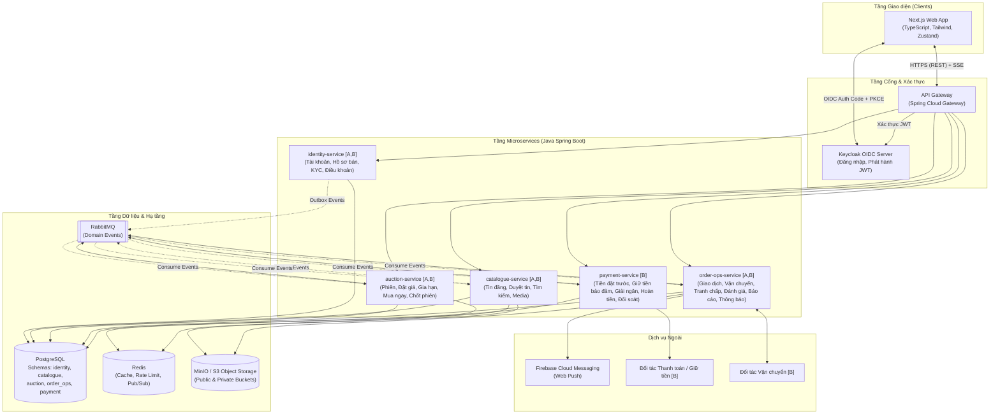
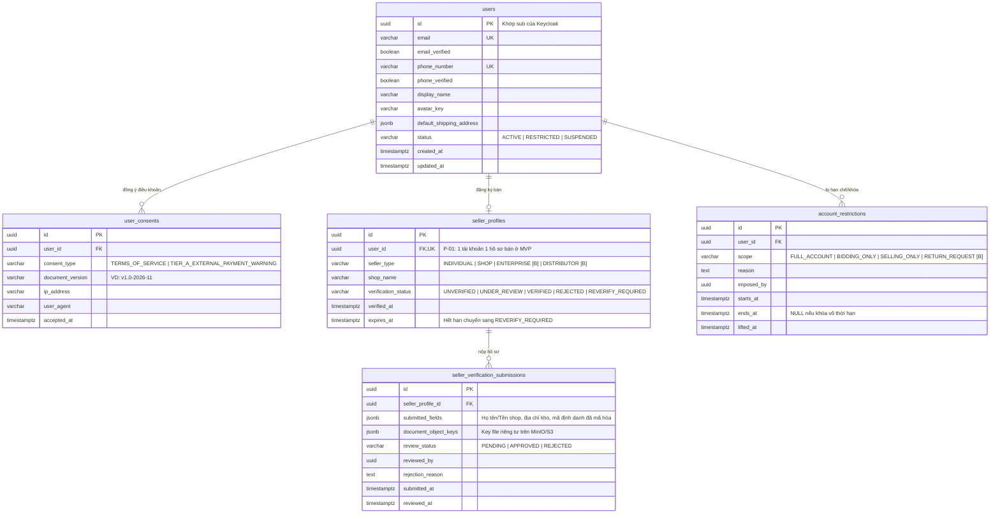
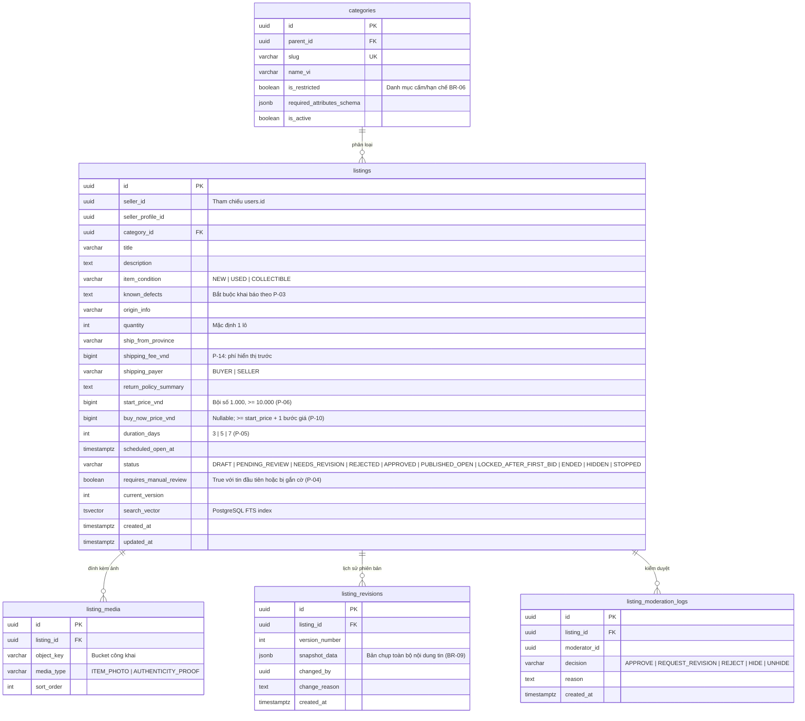
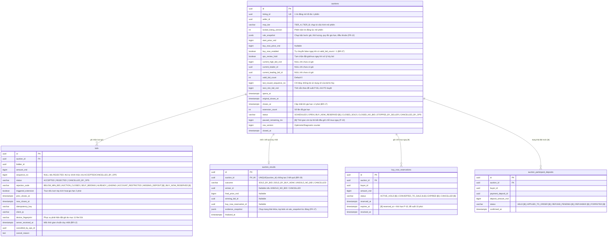
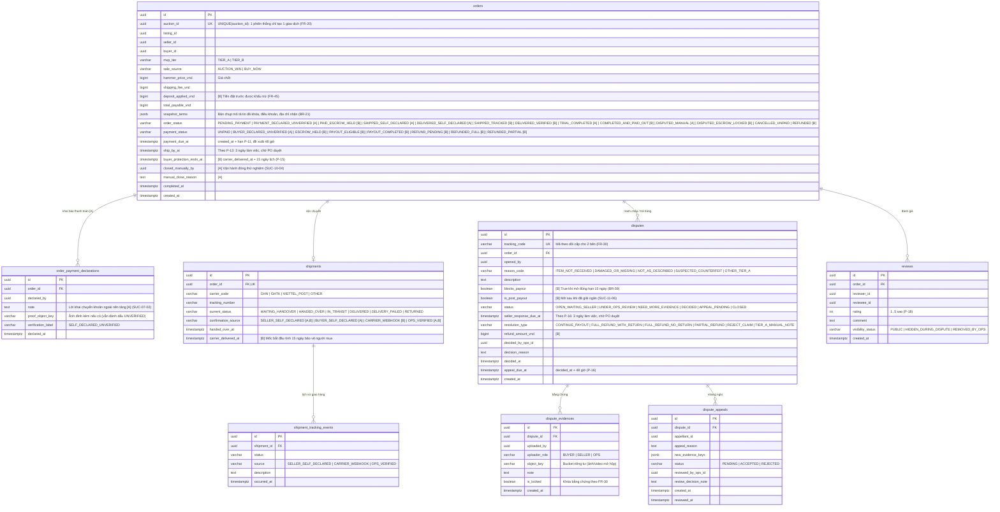
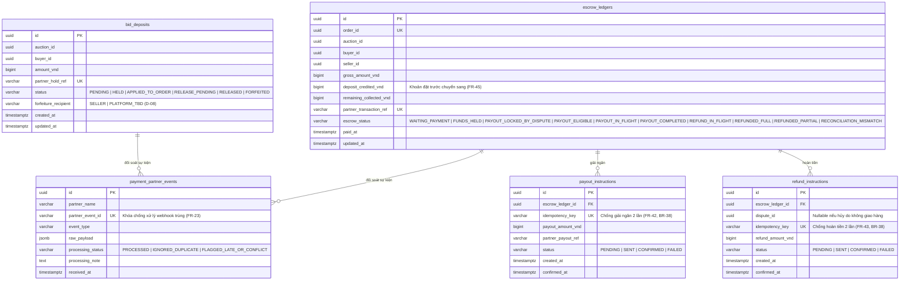
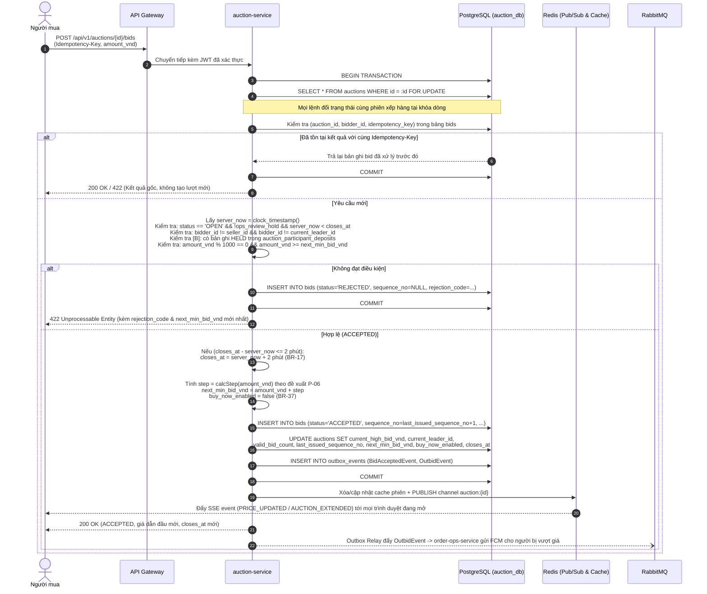
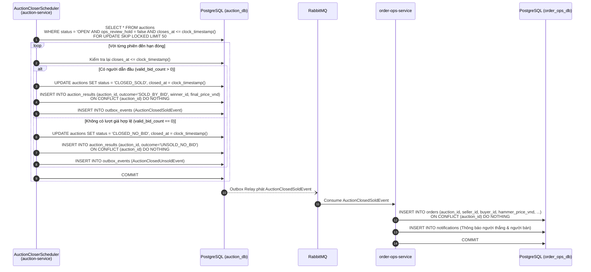
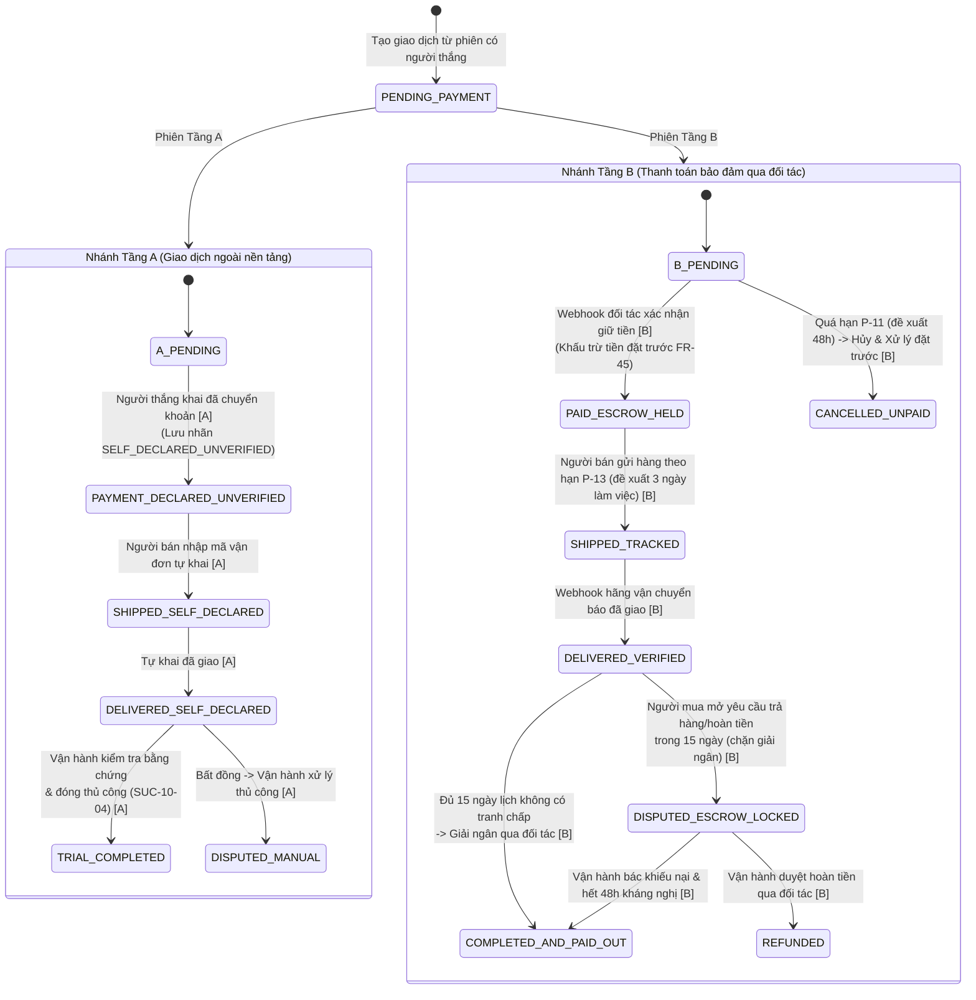

# 04 — Thiết kế Hệ thống Chi tiết (Architecture Design)

## 1. Thông tin tài liệu và quyết định kiến trúc

| Thuộc tính | Nội dung |
|---|---|
| Dự án | AuctionNoow — nền tảng đấu giá trực tuyến tại Việt Nam |
| Phiên bản | 1.0 — Thiết kế chi tiết cho cả hai tầng `[A]` và `[B]` |
| Ngày cập nhật | 2026-11-10 |
| Đầu vào | [01b-mvp-scope.md](../01-product/01b-mvp-scope.md), [02-requirements-business-rules.md](../02-requirements/02-requirements-business-rules.md), [03-use-cases-user-flows.md](../03-use-cases/03-use-cases-user-flows.md), [architecture-research.md](architecture-research.md) |
| Trạng thái | Bản thiết kế kỹ thuật đề xuất; các lựa chọn kiến trúc và tham số P chưa được PO duyệt để triển khai |

**Quy ước ký hiệu phạm vi:**
- `[A]`: Chỉ áp dụng ở **Tầng A** (thử nghiệm kín; hai bên tự thanh toán/giao hàng ngoài nền tảng; hệ thống chỉ ghi nhận lời khai chưa đối soát và đóng giao dịch thử nghiệm thủ công).
- `[B]`: Chỉ áp dụng ở **Tầng B** sau cổng pháp lý và đối tác `D-04`. PO đã chọn hướng tiền đặt trước `D-08` và bảo vệ người mua 15 ngày `D-09`; thời gian giữ chỗ 10 phút `P-10` vẫn là tham số chờ PO.
- `[A,B]`: Dùng chung cho cả hai tầng mà không phải thiết kế lại lõi nghiệp vụ.

### 1.1. Trạng thái các lựa chọn kiến trúc

**Người dùng/PO đã chọn hướng:** MVP triển khai Tầng A rồi Tầng B; lõi đấu giá tuần tự hóa thay đổi trạng thái phiên và dùng thời gian máy chủ. Bảng dưới là phương án kỹ thuật để thiết kế, chưa phải toàn bộ quyết định phát hành. `P-06` (bậc bước giá), `P-10` (giữ chỗ mua ngay, đề xuất 10 phút) và `P-11` (hạn thanh toán 48 giờ, nhắc sau 24 giờ) là **tham số chờ PO**. Các giá trị xuất hiện bên dưới chỉ mô tả hành vi nếu PO duyệt phương án đó.

| Hạng mục | Phương án kỹ thuật | Trạng thái | Truy vết |
|---|---|---|---|
| Ranh giới Microservices | Khởi đầu với **4 service nghiệp vụ cốt lõi** (`identity-service`, `catalogue-service`, `auction-service`, `order-ops-service`) đứng sau **API Gateway** (`api-gateway`); tách riêng **`payment-service`** khi mở Tầng B | Đề xuất trong nghiên cứu; ranh giới cụ thể chờ duyệt | Mục 2.1 [architecture-research.md](architecture-research.md) |
| Xác thực & Phân quyền | Dùng **Keycloak (OIDC)** quản lý đăng nhập, phiên và phát hành JWT; các microservice đóng vai trò **Spring Security OAuth2 Resource Server**; dữ liệu nghiệp vụ (hồ sơ bán, xác minh, điều khoản, khóa quyền) do `identity-service` sở hữu | OIDC là hướng nghiên cứu; Keycloak và cách triển khai là đề xuất | FR-01..05, BR-01..05 |
| Cơ sở dữ liệu chính | **PostgreSQL** là nguồn sự thật duy nhất (Single Source of Truth). Dùng chung 1 cụm PostgreSQL vật lý ở giai đoạn đầu nhưng **tách schema và DB user riêng cho từng service** (Database-per-Service về mặt logic) | Đề xuất kỹ thuật | NFR-01, NFR-03 |
| Đồng bộ & Thứ tự đặt giá | Tuần tự hóa mọi thao tác làm thay đổi trạng thái phiên (`đặt giá`, `mua ngay`, `đóng phiên`, `dừng phiên`) bằng **khóa dòng `SELECT ... FOR UPDATE`** trên bảng `auctions` tại `auction-service`, lấy thời gian chuẩn từ máy chủ | Yêu cầu tính đúng đã chọn; khóa dòng là đề xuất triển khai | BR-12..19, BR-36, NFR-01 |
| Cache & Cập nhật thời gian thực | **Redis** dùng cho: (1) cache đọc `cache-aside` trang tin/phiên, (2) rate-limiting theo tài khoản/IP, (3) **Redis Pub/Sub** phát tín hiệu tới các bản sao `auction-service` để đẩy **SSE (Server-Sent Events)** xuống trình duyệt | Đề xuất; Redis Pub/Sub không phải nguồn sự thật | FR-13, NFR-05 |
| Sự kiện bất đồng bộ | **RabbitMQ** kết hợp mẫu **Transactional Outbox** tại từng service và **Idempotent Consumer** (chống xử lý trùng bằng `event_id` và khóa nghiệp vụ) | Đề xuất trong nghiên cứu, chờ duyệt | NFR-02, BR-19, FR-23 |
| Lưu trữ tệp (Ảnh & Bằng chứng) | Tích hợp qua chuẩn **S3 API (MinIO)** với **Presigned URL**. Tách bucket/prefix công khai (ảnh sản phẩm) và riêng tư (giấy tờ xác minh người bán, video/ảnh bằng chứng tranh chấp) | Đề xuất kỹ thuật | FR-04, FR-06, FR-30, BR-30, NFR-04 |
| Thông báo người dùng | Lưu lịch sử thông báo chính thức trong PostgreSQL (`order-ops-service`) và gửi Web Push qua **Firebase Cloud Messaging (FCM)** | Đề xuất kỹ thuật | FR-16, FR-21, NFR-05 |

---

## 2. Kiến trúc tổng thể & Ranh giới Microservices

### 2.1. Sơ đồ kiến trúc thành phần (C4 Container View)



### 2.2. Phân bổ trách nhiệm và ánh xạ Use Case theo Service

| Service | Schema sở hữu | Trách nhiệm cốt lõi | BUC / SUC ánh xạ |
|---|---|---|---|
| **`identity-service`** `[A,B]` | `identity_db` | Đồng bộ hồ sơ từ Keycloak, xác thực email/SĐT, lưu lịch sử đồng ý điều khoản/cảnh báo theo phiên bản (`BR-05`, `M-D4`), quản lý hồ sơ người bán (`cá nhân`, `shop` ở `[A]`; mở rộng `doanh nghiệp`, `nhà phân phối` ở `[B]`), duyệt xác minh người bán, khóa/hạn chế tài khoản | `BUC-01` (`SUC-01-01`..`07`), `BUC-02` (`SUC-02-01`..`04`), `SUC-08-03`, `SUC-13-03` |
| **`catalogue-service`** `[A,B]` | `catalogue_db` | Tạo/sửa bản nháp tin đăng, cấp Presigned URL tải ảnh sản phẩm, cấu hình thông số phiên dự kiến, hàng đợi duyệt tin thủ công (100% tin đầu tiên và tin gắn cờ theo `P-04`), khóa sửa trường trọng yếu sau khi có giá đầu tiên (`BR-09`), tìm kiếm & lọc tin bằng PostgreSQL Full-Text Search, ẩn/gỡ tin | `BUC-03` (`SUC-03-01`..`05`), `BUC-04` (`SUC-04-01`, `02`), `SUC-13-02`, `SUC-14-01` |
| **`auction-service`** `[A,B]` | `auction_db` | Mở phiên theo lịch và chụp bản khóa quy tắc/tin đăng (`FR-12`), xử lý đặt giá đồng thời dưới khóa dòng, kiểm tra bậc bước giá (`P-06`), gia hạn mềm 2 phút cuối (`BR-17`), xử lý Mua ngay (`[A]` chốt ngay, `[B]` giữ chỗ theo P-10 (đề xuất 10 phút)), đóng phiên idempotent (`BR-19`), hủy lượt giá/dừng phiên bởi vận hành, phát SSE thời gian thực | `SUC-03-06`, `BUC-05` (`SUC-05-01`..`06`), `BUC-06` (`SUC-06-01`, `02`), `SUC-13-04`, `SUC-14-02`, `14-03` |
| **`order-ops-service`** `[A,B]` | `order_ops_db` | Tạo giao dịch từ sự kiện chốt phiên (`SUC-06-03`), ghi nhận thanh toán tự khai `[A]`, quản lý hạn thanh toán và nhắc theo P-11 (đề xuất 48h/24h, chờ PO), quản lý vận chuyển (tự khai `[A]`, tích hợp hãng `[B]`), đóng giao dịch thử nghiệm thủ công `[A]` (`SUC-10-04`) hoặc tự động sau 15 ngày `[B]` (`SUC-10-01`), xử lý tranh chấp/trả hàng/kháng nghị (`BUC-11`), đánh giá (`BUC-12`), báo cáo vi phạm & thống kê vận hành (`BUC-13`), gửi thông báo FCM | `SUC-06-03`, `SUC-07-01`, `02`, `BUC-08` (`SUC-08-01`), `BUC-09` (`SUC-09-01`..`04`), `BUC-10` (`SUC-10-01`, `04`), `BUC-11` (`SUC-11-01`..`06`), `BUC-12`, `BUC-13` |
| **`payment-service`** `[B]` | `payment_db` | Thu/giữ/hoàn/tịch thu tiền đặt trước theo phiên (`FR-44`, `FR-45`, `D-08`), nhận thanh toán giữ chỗ Mua ngay theo P-10 (đề xuất 10 phút, chờ PO), nhận tiền thanh toán giao dịch vào tài khoản bảo đảm đối tác (`FR-41`), thực thi lệnh giải ngân (`FR-42`) và hoàn tiền (`FR-43`), xử lý webhook trùng/muộn (`FR-23`) và đối soát (`SUC-07-05`) | `SUC-05-05`, `SUC-07-03`..`05`, `SUC-08-02`, `SUC-10-02`, `10-03` |

> [!IMPORTANT]
> **Nguyên tắc giảm gọi đồng bộ xuyên service (Zero Cross-Service Sync Call trên đường găng đặt giá):**
> Khi người dùng gọi `POST /api/v1/auctions/{id}/bids`, `auction-service` **không gọi HTTP sang `identity-service` hay `payment-service`** trong lúc đang giữ khóa dòng database. Thay vào đó:
> 1. `auction-service` kiểm tra trạng thái đủ điều kiện đặt giá (`email_verified`, `phone_verified`, `terms_version`, `is_restricted`) từ **read-model trong cơ sở dữ liệu của chính service**, đồng bộ qua sự kiện thay đổi từ `identity-service`; JWT chỉ xác định danh tính, không dùng claims làm nguồn quyền đặt giá. Khi khóa tài khoản, phải có cơ chế chặn đồng bộ/đợi read-model xác nhận cập nhật trước khi coi lệnh khóa có hiệu lực; sự kiện đến chậm thì tạm từ chối đặt giá khi trạng thái quyền chưa chắc chắn (`TC-03`).
> 2. Ở Tầng B, trạng thái tiền đặt trước hợp lệ (`HELD`) của `(auction_id, buyer_id)` được đồng bộ về bảng `auction_participant_deposits` trong `auction_db` ngay khi `payment-service` xác nhận với đối tác.

---

## 3. Thiết kế Cơ sở Dữ liệu (Database Schema theo từng Service)

Tất cả các bảng dùng khóa chính `UUID` (chuẩn UUIDv7 để tối ưu thứ tự B-Tree index), mốc thời gian lưu dạng `TIMESTAMPTZ` (UTC tại máy chủ, hiển thị `Asia/Ho_Chi_Minh` ở giao diện), và tiền tệ lưu dạng `BIGINT` (số nguyên VND, kèm cột `currency VARCHAR(3) DEFAULT 'VND'` theo `NFR-07`).

Mỗi schema đều có 2 bảng hạ tầng chuẩn:
- `outbox_events(id UUID PK, aggregate_type VARCHAR, aggregate_id UUID, event_type VARCHAR, payload JSONB, created_at TIMESTAMPTZ, published_at TIMESTAMPTZ)` để đảm bảo Transactional Outbox.
- `audit_logs(id UUID PK, actor_id UUID, actor_role VARCHAR, action VARCHAR, entity_type VARCHAR, entity_id UUID, before_state JSONB, after_state JSONB, reason TEXT, correlation_id VARCHAR, created_at TIMESTAMPTZ)` theo `FR-36` và `NFR-03`.

### 3.1. Schema `identity_db` (`identity-service`) `[A,B]`



### 3.2. Schema `catalogue_db` (`catalogue-service`) `[A,B]`



### 3.3. Schema `auction_db` (`auction-service`) `[A,B]`

Đây là schema quan trọng nhất đảm bảo tính đúng đắn của đấu giá (`NFR-01`).



**Các ràng buộc dữ liệu (Database Constraints) bắt buộc trên `auction_db`:**
1. `UNIQUE (auction_id)` trên bảng `auction_results`: Đảm bảo ở mức cơ sở dữ liệu rằng một phiên chỉ có **đúng một kết quả chính thức** (`BR-19`, `BR-36`), dù job đóng phiên hay mua ngay có bị gọi lặp.
2. Partial Unique Index `CREATE UNIQUE INDEX idx_accepted_bid_sequence ON bids(auction_id, sequence_no) WHERE sequence_no IS NOT NULL`: lượt bị từ chối có `sequence_no = NULL`; lượt từng được chấp nhận rồi bị vận hành hủy vẫn giữ số thứ tự lịch sử, không tái sử dụng (`NFR-01`).
3. `UNIQUE (auction_id, bidder_id, idempotency_key)` trên bảng `bids`: Chống gửi lặp yêu cầu đặt giá do mạng chậm (`NFR-02`, `SUC-05-01`).
4. Partial Unique Index `CREATE UNIQUE INDEX idx_one_active_buy_now_hold ON buy_now_reservations(auction_id) WHERE status IN ('ACTIVE_HOLD', 'CONVERTED_TO_SALE')`: Chặn tuyệt đối hai người cùng giữ chỗ hoặc cùng mua ngay thành công trên một phiên (`TC-55`, `TC-114`).
5. Quy tắc `P-10` (mỗi tài khoản tối đa một lần giữ chỗ thất bại trên một phiên, `TC-56`) được kiểm tra trong code **sau khi khóa dòng phiên**. Có thể thêm hàng rào cơ sở dữ liệu bằng `CREATE UNIQUE INDEX idx_one_expired_hold_per_buyer ON buy_now_reservations(auction_id, buyer_id) WHERE status = 'EXPIRED'`; đây là ràng buộc riêng, không thay thế kiểm tra nghiệp vụ.

`mvp_tier` được chọn từ cấu hình phát hành của hệ thống khi mở phiên, ghi bất biến vào `auctions` và sao chép sang `orders`; không đổi tầng của một phiên đang chạy. Việc cho phép mở Tầng B phụ thuộc cổng pháp lý và đối tác `D-04`, không do người bán tự chọn.

`approved_listing_count` do `catalogue-service` tính từ các tin đã duyệt; `rating_avg` và `rating_count` do `order-ops-service` tính từ đánh giá. Nếu màn hình hồ sơ cần các số này, `identity-service` chỉ giữ bản sao đọc cập nhật bằng sự kiện, có version/thời điểm cập nhật và chịu được trễ; không coi bản sao là nguồn sự thật.

### 3.4. Schema `order_ops_db` (`order-ops-service`) `[A,B]`



> [!NOTE]
> Trong `order_ops_db` còn có 2 bảng vận hành và thông báo:
> - `abuse_reports(id, reporter_id, target_type, target_id, reason_code, description, status, assigned_ops_id, resolution_note, created_at)` phục vụ `FR-34`, `SUC-11-05` (báo cáo hàng giả sau 15 ngày) và `SUC-13-01`.
> - `notifications(id, recipient_id, type, title, body, action_url, is_read, fcm_delivery_status, created_at)` phục vụ lưu lịch sử thông báo (`NFR-05`) và đẩy FCM (`SUC-05-06`).

### 3.5. Schema `payment_db` (`payment-service`) `[B]`

Chỉ kích hoạt khi mở Tầng B (sau cổng `D-04`):



---

## 4. Thiết kế Luồng Xử lý Cốt lõi & Xử lý Đồng thời

### 4.1. Luồng Đặt giá, Gia hạn mềm 2 phút & Phân xử cạnh tranh (`SUC-05-01`, `SUC-05-02`) `[A,B]`

Mọi yêu cầu `POST /api/v1/auctions/{auctionId}/bids` được thực thi trong một database transaction ngắn tại `auction-service` theo đúng trình tự sau:



**Công thức bậc bước giá đề xuất `P-06` (tham số chờ PO; nếu duyệt, cài đặt trong `AuctionStepCalculator`):**
- Nếu `valid_bid_count == 0`: `next_min_bid_vnd = start_price_vnd`.
- Nếu `valid_bid_count > 0`: `next_min_bid_vnd = current_high_bid_vnd + step(current_high_bid_vnd)` với:
  - `current_high_bid_vnd < 100_000` → `step = 5_000`
  - `100_000 <= current_high_bid_vnd < 1_000_000` → `step = 10_000`
  - `1_000_000 <= current_high_bid_vnd < 5_000_000` → `step = 50_000`
  - `5_000_000 <= current_high_bid_vnd < 20_000_000` → `step = 100_000`
  - `current_high_bid_vnd >= 20_000_000` → `step = 500_000`

### 4.1.1. Vận hành hủy lượt giá (`P-08`, đề xuất chờ PO)

Vận hành gửi lệnh kèm lý do và bằng chứng; `auction-service` khóa dòng `auctions` bằng `FOR UPDATE`, kiểm tra phiên chưa có kết quả cuối, rồi đổi lượt đã chấp nhận sang `CANCELLED_BY_OPS` mà không xóa lịch sử hoặc tái sử dụng `sequence_no`. Từ các lượt còn `ACCEPTED`, tính lại `valid_bid_count`, `current_leading_bid_id`, `current_leader_id`, `current_high_bid_vnd` và `next_min_bid_vnd` theo `rule_snapshot`; nếu không còn lượt nào thì giá tối thiểu trở về `start_price_vnd`. Ghi audit và outbox trong cùng transaction, sau commit mới phát SSE/thông báo cho người bị ảnh hưởng. Lệnh lặp dùng cùng khóa chống gửi lặp và trả kết quả gốc.

**Cần PO quyết định trước khi triển khai P-08:** (1) Khi số lượt hợp lệ trở về 0, có bật lại Mua ngay hay giữ trạng thái đã tắt? (2) Nếu lượt bị hủy từng gây gia hạn, có khôi phục giờ đóng trước đó hay giữ giờ hiện tại? Trước khi chốt, không tự động thay `buy_now_enabled` hoặc `closes_at` khi hủy; đặt `ops_review_hold = true`, đưa phiên vào hàng đợi vận hành và từ chối lượt giá/mua ngay mới. Job đóng phiên cũng bỏ qua phiên đang giữ để xử lý. Chỉ bỏ cờ sau khi quyết định được ghi nhận và giờ đóng hợp lệ được xác lập. Không được âm thầm áp dụng một trong hai chính sách.

### 4.2. Luồng Mua ngay & Phân xử cạnh tranh với Lượt giá đầu tiên (`SUC-05-04`) `[A,B]`

Yêu cầu `POST /api/v1/auctions/{auctionId}/buy-now` **khóa cùng dòng `SELECT ... FOR UPDATE` trên bảng `auctions`** như yêu cầu đặt giá:
1. Nếu `valid_bid_count > 0` hoặc `buy_now_enabled == false` hoặc `ops_review_hold == true` hoặc `status != 'OPEN'`: từ chối ngay (`BUY_NOW_UNAVAILABLE`, `TC-54`, `TC-114`).
2. **Ở Tầng A (`mvp_tier == 'TIER_A'`)**:
   - Tạo bản ghi `buy_now_reservations` với `status = 'CONVERTED_TO_SALE'`.
   - Chuyển `auctions.status = 'CLOSED_SOLD'`, `closed_at = server_now`.
   - Ghi `auction_results` (`outcome = 'SOLD_BY_BUY_NOW'`, `winner_id = buyer_id`, `final_price_vnd = buy_now_price_vnd`) và phát sự kiện `AuctionClosedEvent` trong `outbox_events` để `order-ops-service` tạo ngay một giao dịch thử nghiệm (`TC-109`).
3. **Ở Tầng B (`mvp_tier == 'TIER_B'`)**:
   - Kiểm tra xem `(auction_id, buyer_id)` đã có bản ghi `buy_now_reservations` nào ở trạng thái `EXPIRED` chưa; nếu có thì từ chối theo `P-10` (`TC-56`).
   - Lưu `paused_remaining_ms = EXTRACT(EPOCH FROM (closes_at - server_now)) * 1000`.
   - Chuyển `auctions.status = 'BUY_NOW_RESERVED'`. Mọi yêu cầu đặt giá đến trong lúc này sẽ bị từ chối với mã `BUY_NOW_RESERVED` (`TC-51`).
   - Tạo bản ghi `buy_now_reservations` với `status = 'ACTIVE_HOLD'`, `expires_at = server_now + hold_duration` (đề xuất 10 phút, chờ PO).
   - Nếu `payment-service` nhận webhook thanh toán thành công từ đối tác trước `expires_at`: khóa dòng phiên, chuyển sang `CLOSED_SOLD`, ghi `auction_results` và tạo giao dịch (`TC-52`).
   - Nếu quá hạn P-10 (đề xuất 10 phút) không thanh toán: job quét `buy_now_reservations` quá hạn sẽ khóa dòng phiên, đổi `buy_now_reservations.status = 'EXPIRED'`, khôi phục `auctions.status = 'OPEN'` và đặt `closes_at = server_now + GREATEST(paused_remaining_ms, minimum_resume_ms)` (tối thiểu còn 2 phút theo `P-10`, `TC-53`).

### 4.3. Luồng Đóng phiên Idempotent & Tạo Giao dịch (`SUC-06-01` → `SUC-06-03`) `[A,B]`



### 4.4. Luồng Sau Đấu giá: Khác biệt giữa Tầng A và Tầng B (`BUC-07` → `BUC-11`)

Các trạng thái trong sơ đồ dùng đúng giá trị `orders.order_status`; `A_PENDING` và `B_PENDING` chỉ là nút vào sơ đồ, không lưu vào cơ sở dữ liệu. Các hạn 3 ngày làm việc của `P-13`/`P-16` cần lịch Việt Nam có cuối tuần, ngày lễ và ngày nghỉ bù theo năm; tính hạn theo múi giờ `Asia/Ho_Chi_Minh`, lưu kết quả UTC cùng phiên bản lịch dùng để tính. Khi chưa có lịch được duyệt, không tự động kết luận quá hạn.



---

## 5. Thiết kế Giao tiếp: REST API, SSE & Sự kiện Bất đồng bộ

### 5.1. Danh mục REST API chính qua API Gateway (`/api/v1/...`)

Tất cả các lệnh ghi (`POST`, `PUT`, `PATCH`) thay đổi trạng thái phiên, giao dịch hoặc tiền đều nhận header `Idempotency-Key` (`UUID`) và trả kèm `X-Correlation-Id`.

#### A. `identity-service` (`[A,B]`)
| Method & Path | Quyền | Mô tả | SUC / TC |
|---|---|---|---|
| `GET /api/v1/users/me` | Authenticated | Lấy hồ sơ cá nhân, trạng thái xác thực email/SĐT, phiên bản điều khoản đã đồng ý và quyền hiện hành | `SUC-01-06` |
| `PATCH /api/v1/users/me` | Authenticated | Cập nhật thông tin cá nhân (không sửa dữ liệu đã chụp trong `orders.snapshot_terms`) | `SUC-01-06`, `TC-06` |
| `POST /api/v1/users/me/consents` | Authenticated | Ghi nhận đồng ý điều khoản hoặc cảnh báo giao dịch ngoài nền tảng kèm phiên bản | `SUC-01-04`, `TC-04` |
| `GET /api/v1/users/{id}/public-profile` | Public | Xem hồ sơ công khai, trạng thái xác minh và điểm uy tín (ẩn CCCD/SĐT/địa chỉ riêng) | `SUC-01-07`, `TC-07` |
| `POST /api/v1/seller-profiles` | Authenticated | Tạo hồ sơ người bán (`INDIVIDUAL` hoặc `SHOP` ở `[A]`) và gửi hồ sơ xác minh | `SUC-02-01`, `02`, `TC-08`..`13` |
| `POST /api/v1/ops/seller-profiles/{id}/review` | Role `OPS` | Duyệt (`VERIFIED`) hoặc từ chối (`REJECTED`) hồ sơ người bán kèm lý do | `SUC-02-03`, `TC-10`, `11` |
| `POST /api/v1/ops/users/{id}/restrictions` | Role `OPS` | Khóa hoặc hạn chế quyền đặt giá/bán hàng của tài khoản có ghi nhật ký | `SUC-08-03`, `SUC-13-03` |

#### B. `catalogue-service` (`[A,B]`)
| Method & Path | Quyền | Mô tả | SUC / TC |
|---|---|---|---|
| `POST /api/v1/listings/media/presign-upload` | Verified Seller | Cấp Presigned PUT URL lên MinIO/S3 cho ảnh sản phẩm | `SUC-03-01` |
| `POST /api/v1/listings` | Verified Seller | Tạo bản nháp tin đăng (`DRAFT`) kèm cấu hình phiên đấu giá | `SUC-03-01`, `02` |
| `PUT /api/v1/listings/{id}` | Verified Seller | Sửa tin đăng (chặn sửa trường trọng yếu nếu phiên đã có giá hợp lệ đầu tiên) | `SUC-03-05`, `TC-20`, `21` |
| `POST /api/v1/listings/{id}/submit` | Verified Seller | Xem tổng hợp và gửi duyệt (`PENDING_REVIEW`) | `SUC-03-03`, `TC-14`..`18` |
| `GET /api/v1/listings` | Public | Tìm kiếm và lọc tin công khai theo từ khóa, danh mục, trạng thái | `SUC-04-01`, `TC-25`..`28` |
| `GET /api/v1/listings/{id}` | Public | Xem chi tiết tin đăng, lịch sử phiên bản công khai và thông tin phiên | `SUC-04-02`, `TC-23` |
| `POST /api/v1/ops/listings/{id}/moderation` | Role `OPS` | Duyệt, yêu cầu sửa (`NEEDS_REVISION`), từ chối hoặc ẩn/gỡ tin kèm lý do | `SUC-03-04`, `SUC-13-02` |

#### C. `auction-service` (`[A,B]`)
| Method & Path | Quyền | Mô tả | SUC / TC |
|---|---|---|---|
| `GET /api/v1/auctions/{id}` | Public | Lấy trạng thái chính thức mới nhất của phiên, giá dẫn đầu, `closes_at`, 20 lượt giá gần nhất | `SUC-05-03` |
| `GET /api/v1/auctions/{id}/stream` | Public | Kết nối **SSE** nhận sự kiện giá mới, gia hạn 2 phút, giữ chỗ mua ngay, đóng phiên | `SUC-05-03` |
| `POST /api/v1/auctions/{id}/bids` | Eligible Buyer | Gửi lượt đặt giá thủ công (xử lý tuần tự dưới khóa dòng, tự động gia hạn nếu ở 2 phút cuối) | `SUC-05-01`, `02`, `TC-29`..`41` |
| `POST /api/v1/auctions/{id}/buy-now` | Eligible Buyer | Xác nhận Mua ngay (`[A]` chốt giao dịch thử nghiệm ngay; `[B]` giữ chỗ theo P-10 (đề xuất 10 phút)) | `SUC-05-04`, `TC-50`..`56`, `109`, `114` |
| `POST /api/v1/auctions/{id}/stop-by-seller` | Seller (Owner) | Người bán tự dừng phiên khi `valid_bid_count == 0` | `SUC-14-01`, `TC-47`, `48` |
| `POST /api/v1/ops/auctions/{id}/bids/{bidId}/cancel` | Role `OPS` | Vận hành hủy một lượt giá có căn cứ và tính lại người dẫn đầu từ lịch sử hợp lệ | `SUC-14-03`, `TC-45` |
| `POST /api/v1/ops/auctions/{id}/cancel` | Role `OPS` | Vận hành tạm dừng / hủy phiên có căn cứ kèm thông báo cho mọi người tham gia | `SUC-14-02`, `TC-49` |

#### D. `order-ops-service` (`[A,B]`) & `payment-service` (`[B]`)
| Method & Path | Quyền | Mô tả | SUC / TC |
|---|---|---|---|
| `GET /api/v1/orders/{id}` | Buyer / Seller / OPS | Xem chi tiết giao dịch, hạn thanh toán, hạn bàn giao và cảnh báo tầng A | `SUC-07-01`, `SUC-09-01` |
| `POST /api/v1/orders/{id}/declare-external-payment` `[A]` | Buyer (Winner) | Người thắng khai đã chuyển khoản ngoài nền tảng (`BUYER_DECLARED_UNVERIFIED`) | `SUC-07-02`, `TC-59` |
| `POST /api/v1/payments/deposits` `[B]` | Eligible Buyer | Tạo yêu cầu nộp tiền đặt trước qua đối tác cho một phiên đấu giá | `SUC-05-05`, `TC-96`, `97` |
| `POST /api/v1/payments/orders/{id}/checkout` `[B]` | Buyer (Winner) | Tạo phiên thanh toán bảo đảm qua đối tác (đã trừ khoản đặt trước) | `SUC-07-03`, `TC-99` |
| `POST /api/v1/payments/webhooks/{partner}` `[B]` | Partner Signature | Nhận webhook xác nhận đặt trước, thanh toán, giải ngân, hoàn tiền (idempotent) | `SUC-07-04`, `TC-61`..`63`, `101` |
| `POST /api/v1/orders/{id}/shipment` | Seller | Nhập mã vận đơn và đơn vị vận chuyển (`SELLER_SELF_DECLARED`) | `SUC-09-02`, `TC-69` |
| `POST /api/v1/ops/orders/{id}/complete-trial` `[A]` | Role `OPS` | Đóng giao dịch thử nghiệm thủ công (`TRIAL_COMPLETED`) khi đủ bằng chứng và không có tranh chấp | `SUC-10-04`, `TC-110`..`113` |
| `POST /api/v1/orders/{id}/disputes` | Buyer / Seller | Mở tranh chấp / yêu cầu trả hàng hoàn tiền (không có lý do "đổi ý" ở `[B]`) | `SUC-11-01`, `TC-76`, `103` |
| `POST /api/v1/disputes/{id}/responses` | Buyer / Seller | Phản hồi tranh chấp và đính kèm bằng chứng | `SUC-11-02` |
| `POST /api/v1/ops/disputes/{id}/decision` | Role `OPS` | Vận hành ra quyết định xử lý tranh chấp (xem kèm dấu hiệu gian lận `FR-48`) | `SUC-11-03`, `TC-80`, `104`..`108` |
| `POST /api/v1/disputes/{id}/appeals` | Buyer / Seller | Gửi kháng nghị trong vòng 48 giờ kèm chứng cứ mới | `SUC-11-04`, `TC-81`, `82` |
| `POST /api/v1/orders/{id}/reviews` | Buyer / Seller | Đánh giá đối tác 1–5 sao một lần trong 30 ngày sau khi giao dịch hoàn tất | `SUC-12-01`, `TC-85`..`88` |
| `POST /api/v1/reports` | Authenticated | Báo cáo tin đăng, tài khoản, đặt giá ảo hoặc hàng giả phát hiện sau 15 ngày | `SUC-13-01`, `SUC-11-05`, `TC-89`, `107` |
| `GET /api/v1/ops/reports/daily-summary` | Role `OPS` | Báo cáo vận hành hàng ngày và danh sách phiên có dấu hiệu đặt giá ảo bất thường | `SUC-13-04`, `05`, `TC-93`..`95` |

### 5.2. Thiết kế Kênh SSE (`GET /api/v1/auctions/{id}/stream`)

1. **Luồng phát sự kiện**: Khi một transaction đặt giá, gia hạn hoặc đóng phiên commit thành công tại `auction-service`, service xuất một bản tin gọn lên Redis Pub/Sub channel `auction:live:{auctionId}` gồm `{ eventType, sequenceNo, currentHighBidVnd, nextMinBidVnd, leaderMaskedName, validBidCount, buyNowEnabled, closesAt, serverTimestamp }`.
2. **Đẩy xuống trình duyệt**: Mọi instance `auction-service` đang giữ kết nối SSE của phiên đó đẩy sự kiện xuống trình duyệt kèm `id: {sequenceNo}`.
3. **Phục hồi khi đứt kết nối (Reconnection & Snapshot Sync)**: Vì Redis Pub/Sub là *at-most-once*, ngay khi trình duyệt kết nối hoặc kết nối lại SSE, client bắt buộc gọi `GET /api/v1/auctions/{id}` để lấy snapshot chính thức từ PostgreSQL/Redis cache và dùng `serverTimestamp` để hiệu chỉnh độ lệch đồng hồ đếm ngược trên giao diện.

### 5.3. Danh mục Sự kiện Bất đồng bộ (RabbitMQ Exchanges & Queues)

Sử dụng một Topic Exchange chính `auctionnoow.domain.events` và Dead-Letter Exchange `auctionnoow.dlx`:

| Routing Key | Publisher | Consumer | Mục đích xử lý |
|---|---|---|---|
| `identity.user.status-changed` | `identity-service` | `auction-service`, `catalogue-service` | Cập nhật cache trạng thái xác thực email/SĐT và khóa tài khoản để chặn đặt giá/đăng bán tức thì |
| `catalogue.listing.approved` | `catalogue-service` | `auction-service` | Khởi tạo bản ghi phiên `SCHEDULED` hoặc `OPEN` với `rule_snapshot` và `locked_listing_version` |
| `auction.bid.first-accepted` | `auction-service` | `catalogue-service` | Khóa chỉnh sửa các trường trọng yếu của tin đăng (`LOCKED_AFTER_FIRST_BID` theo `BR-09`, `TC-21`) |
| `auction.bid.accepted` | `auction-service` | `order-ops-service` | Tạo thông báo và gửi FCM cho người vừa bị vượt giá (`SUC-05-06`) |
| `auction.closed.sold` | `auction-service` | `order-ops-service`, `payment-service [B]`, `catalogue-service` | Tạo giao dịch `orders` (`SUC-06-03`); ở `[B]` chuyển tiền đặt trước người thắng sang đơn hàng và giải phóng đặt trước cho người không thắng (`FR-45`) |
| `auction.closed.unsold` | `auction-service` | `order-ops-service`, `payment-service [B]`, `catalogue-service` | Thông báo người bán không có lượt giá hợp lệ (`SUC-06-02`); hoàn đặt trước `[B]` |
| `payment.deposit.confirmed` `[B]` | `payment-service` | `auction-service` | Ghi nhận `HELD` vào `auction_participant_deposits` để mở quyền đặt giá trên phiên (`FR-44`) |
| `payment.escrow.funded` `[B]` | `payment-service` | `order-ops-service`, `auction-service` | Chuyển `orders.payment_status = 'ESCROW_HELD'` (hoặc chốt phiên nếu là giữ chỗ Mua ngay `P-10`) |
| `order.payout.eligible` `[B]` | `order-ops-service` | `payment-service` | Phát lệnh giải ngân cho người bán sau 15 ngày không tranh chấp hoặc sau khi đóng tranh chấp (`FR-42`) |
| `order.refund.approved` `[B]` | `order-ops-service` | `payment-service` | Phát lệnh hoàn tiền (toàn bộ hoặc một phần) cho người mua theo quyết định tranh chấp (`FR-43`) |

---

## 6. Bảo mật, Quan sát hệ thống & Cấu trúc Triển khai

### 6.1. Kiểm soát Bảo mật và Quyền riêng tư (`NFR-04`, `BR-30`)

1. **Chống lỗi phân quyền mức đối tượng (OWASP API1:2023 — BOLA/IDOR)**:
   - Mọi API truy cập `orders`, `shipments`, `disputes` đều kiểm tra `jwt.sub == order.buyer_id || jwt.sub == order.seller_id || hasRole('OPS')`.
   - Địa chỉ nhận hàng đầy đủ và số điện thoại người mua chỉ trả về cho `seller_id` của đúng giao dịch đó khi giao dịch đã được tạo hợp lệ (`FR-26`).
2. **Phân tách Lưu trữ File trên MinIO / S3**:
   - Bucket `auctionnoow-public`: chỉ chứa ảnh mặt hàng (`listing_media`).
   - Bucket `auctionnoow-private`: chứa ảnh CCCD/giấy tờ xác minh (`seller_verification_submissions`) và ảnh/video bằng chứng tranh chấp (`dispute_evidences`). Không mở public read; chỉ cấp Presigned GET URL có thời hạn ngắn (5 phút) sau khi service đã kiểm tra quyền truy cập của người gọi.

### 6.2. Phát hiện Đặt giá ảo Hỗ trợ Vận hành (`Mục 11 file 01b`, `SUC-13-04`)

Khi `auction-service` xử lý `POST /bids`, hệ thống ghi nhận `client_ip`, `device_fingerprint` (hash từ header thiết bị/phiên) và thời điểm tạo tài khoản. Một truy vấn tổng hợp (Materialized View / Scheduled Check) gắn cờ cảnh báo cho vận hành khi trên cùng một phiên có:
- ≥ 3 tài khoản mới tạo trong 7 ngày cùng đặt giá ở 2 phút cuối (`TC-94`).
- ≥ 2 tài khoản đặt giá có trùng `device_fingerprint`, `client_ip`, số điện thoại hoặc địa chỉ giao hàng (`TC-95`).
Hệ thống chỉ gắn cờ đưa vào hàng đợi kiểm duyệt của vận hành, không tự động hủy kết quả phiên.

### 6.3. Cấu trúc Thư mục Dự án (Monorepo) để chuẩn bị khởi tạo Code

```text
AuctionNoow/
├── docker-compose.yml              # PostgreSQL, Redis, RabbitMQ, MinIO, Keycloak
├── docs/                           # Tài liệu sản phẩm, yêu cầu, use cases, thiết kế
├── frontend/                       # Next.js (TypeScript, Tailwind, Zustand)
└── backend/                        # Maven/Gradle multi-module (Spring Boot)
    ├── common-lib/                 # Chuẩn lỗi, Correlation ID, Outbox base, JWT utils
    ├── api-gateway/                # Spring Cloud Gateway
    ├── identity-service/           # BUC-01, BUC-02
    ├── catalogue-service/          # BUC-03, BUC-04
    ├── auction-service/            # BUC-05, BUC-06, BUC-14
    ├── order-ops-service/          # BUC-07..13 (Tầng A & B)
    └── payment-service/            # BUC-07, BUC-08, BUC-10 (Mở ở Tầng B)
```
